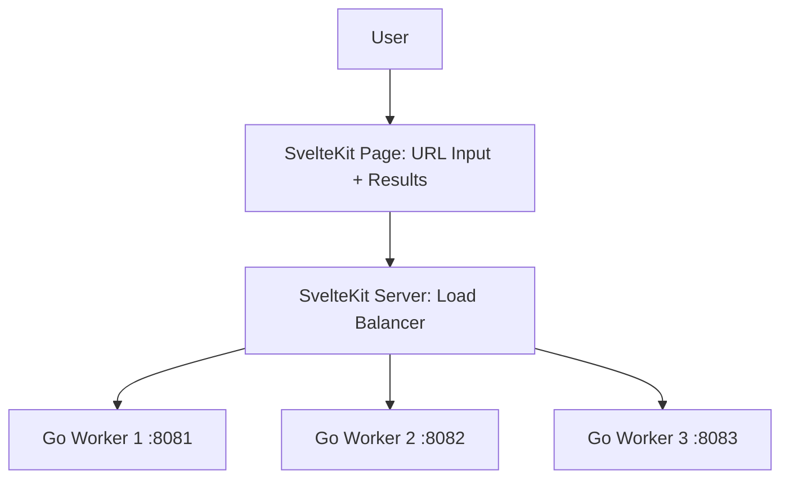

# ScrapeMesh

A simple distributed web scraper built with **SvelteKit** and **Go**. The user pastes a URL, SvelteKit's server-side load balancer picks a worker, and one of three Go servers scrapes it.

> **Note:** This is a personal learning project, focused on load balancing and Go concurrency.

## Overview

SvelteKit does two jobs: it serves the page (a URL input and a results view) and it acts as the **load balancer** in its server-side API routes. The three Go servers are plain **workers** that only know how to scrape a URL. No accounts, no database.

## Architecture



## Components

| Component                     | Responsibility                                                                                         |
| ----------------------------- | ------------------------------------------------------------------------------------------------------ |
| **SvelteKit (frontend)**      | URL input form and results display                                                                     |
| **SvelteKit (server routes)** | Load balancer: tracks workers, picks one, forwards the request, retries on failure, runs health checks |
| **Go Workers (x3)**           | Expose a small HTTP API, fetch the given URL, and return the result                                    |

State (worker list, health status, current load) is kept in memory on the SvelteKit server.

## How It Works

1. The user enters a URL in the SvelteKit page.
2. The page calls a SvelteKit server route (e.g. `POST /api/scrape`).
3. The load balancer in that route picks a healthy worker.
4. It forwards the URL to the chosen Go worker.
5. The worker fetches the URL and returns the result.
6. The result is shown to the user.

## Core Feature: The Load Balancer (in SvelteKit)

The load balancer lives in SvelteKit's server code and should be able to:

- Keep a list of worker addresses and each worker's health (periodic health checks)
- Track each worker's number of in-flight requests
- Pick a worker using a strategy: round-robin first, then least-connections
- Retry on another worker if one fails or goes down

## Worker API

Each Go worker exposes a minimal HTTP API:

| Endpoint       | Description                                 |
| -------------- | ------------------------------------------- |
| `POST /scrape` | Takes a URL, fetches it, returns the result |
| `GET /health`  | Returns 200 if the worker is alive          |

## Tech Stack

- **Frontend and Load Balancer:** SvelteKit (server routes)
- **Workers:** Go (3 instances on different ports)

## Roadmap

- [ ] 1. Build one Go worker with `/scrape` and `/health`
- [ ] 2. Build the SvelteKit page with a URL input and results display
- [ ] 3. Add a SvelteKit server route that forwards requests to the one worker
- [ ] 4. Run three Go workers and balance with round-robin
- [ ] 5. Add health checks and retries
- [ ] 6. Switch to least-connections selection

## Suggested Project Structure

```
scrapemesh/
├── web/                  # SvelteKit app
│   └── src/
│       ├── routes/       # page + /api/scrape route
│       └── lib/server/   # load balancer, worker registry, health checks
├── worker/               # Go scraping worker (run 3 instances)
└── README.md
```

## Learning Goals

- Load balancing algorithms (round-robin, least-connections)
- Health checks, retries, and failure handling
- Go concurrency in the workers (goroutines, HTTP servers)
- Connecting a SvelteKit server to Go backends

## Getting Started

_Coming soon: setup instructions will be added as the project takes shape._
