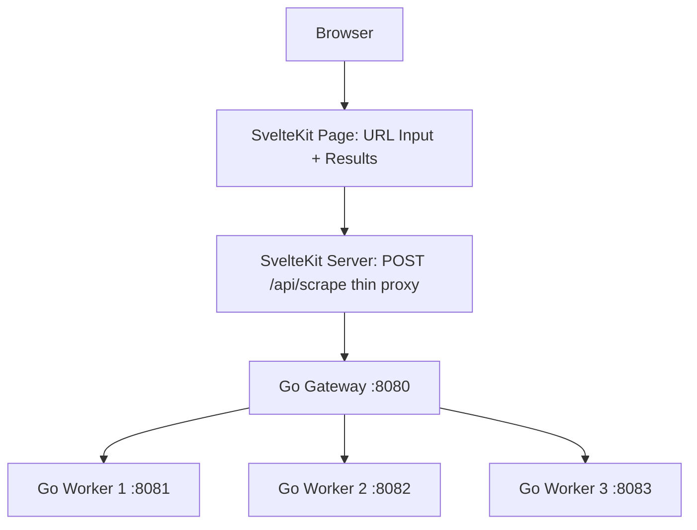

# ScrapeMesh

A simple distributed web scraper built with **SvelteKit** and **Go**. The user pastes a URL, a Go **gateway** picks a healthy worker, and one of three Go workers scrapes it.

> **Note:** This is a personal learning project, focused on load balancing and Go concurrency.

## Overview

The project is split into two tiers:

- **SvelteKit** is the edge: it serves the page (a URL input and a results view) and exposes a single thin API route (`POST /api/scrape`) that forwards requests to the gateway. It holds no balancing logic.
- **Go** is the backend. The **gateway** owns routing, health checks, load tracking, and retries. The **workers** are plain stateless processes that only know how to scrape a URL.

No accounts, no database. All routing state lives in memory in the gateway process.

## Architecture



## Components

| Component                        | Responsibility                                                                          |
| -------------------------------- | --------------------------------------------------------------------------------------- |
| **SvelteKit (frontend)**         | URL input form and results display                                                      |
| **SvelteKit (server routes)**    | Thin edge proxy: validates input and forwards `POST /api/scrape` to the Go gateway       |
| **Go Gateway (`cmd/gateway`)**   | Load balancer: worker registry, health checks, in-flight tracking, selection, retries     |
| **Go Workers (`cmd/worker`, x3)**| Expose `POST /scrape` + `GET /health`, fetch the given URL, and return the result        |

State (worker list, health status, in-flight counts) is kept in memory on the gateway process. This is why SvelteKit must run as a long-lived Node server (`adapter-node`), not on a serverless platform — and why the gateway exists as its own process at all.

## How It Works

1. The user enters a URL on the SvelteKit page.
2. The page calls the SvelteKit route `POST /api/scrape`.
3. That route validates the request and forwards it to the Go gateway.
4. The gateway picks a healthy worker using its selection strategy.
5. The gateway forwards the URL to the chosen worker.
6. The worker fetches the URL and returns the result.
7. The gateway records latency/health and returns the result.
8. SvelteKit passes the result back and the page displays it.

## Core Feature: The Load Balancer (in Go)

The gateway owns all balancing and should be able to:

- Keep a list of worker addresses and each worker's health (periodic health checks via a `time.Ticker`)
- Track each worker's number of in-flight requests (atomic counters)
- Pick a worker using a strategy: round-robin first, then least-connections
- Retry on another worker if one fails or goes down
- Return metadata (chosen worker, latency, retry count) so the UI can show the balancing happen

## API

### Gateway (`:8080`)

| Endpoint       | Description                                                                       |
| -------------- | --------------------------------------------------------------------------------- |
| `POST /scrape` | Takes `{url, mode, timeoutMs}`, selects a worker, forwards, retries on failure    |
| `GET /health`  | Returns gateway status and the current worker registry                            |

### Worker (`:8081`, `:8082`, `:8083`)

| Endpoint       | Description                                                       |
| -------------- | ----------------------------------------------------------------- |
| `POST /scrape` | Takes a URL, fetches it, returns `{ok, statusCode, finalUrl, body, durationMs, workerId}` |
| `GET /health`  | Returns `200` with `{status, inflight}` if the worker is alive     |

## Tech Stack

- **Frontend + edge proxy:** SvelteKit (server routes, `adapter-node`)
- **Gateway (load balancer):** Go (Fiber)
- **Workers:** Go (Fiber, 3 instances on different ports)

## Roadmap

- [ ] 1. Build one Go worker with `/scrape` and `/health`
- [x] 2. Build the SvelteKit page with a URL input and results display
- [ ] 3. Add a SvelteKit route that forwards requests to the Go gateway
- [ ] 4. Build the Go gateway and run three workers behind it
- [ ] 5. Balance with round-robin
- [ ] 6. Add health checks and retries
- [ ] 7. Switch to least-connections selection

## Project Structure

```
scrapemesh/
├── client/                    # SvelteKit app (page + /api/scrape edge proxy)
│   └── src/
│       └── routes/
│           ├── +page.svelte   # URL input + results view
│           └── api/scrape/    # thin forwarder to the Go gateway
├── server/                    # Go
│   ├── cmd/
│   │   ├── gateway/           # load balancer: registry, health, selection, retries
│   │   └── worker/            # scraping worker (run 3 instances)
│   └── go.mod
└── README.md
```

## Getting Started

Run each process in its own terminal:

```sh
# 1. Three Go workers
cd server
go run ./cmd/worker 8081
go run ./cmd/worker 8082
go run ./cmd/worker 8083

# 2. Go gateway (knows the three worker addresses)
go run ./cmd/gateway

# 3. SvelteKit edge
cd client
bun install
bun run dev
```

Then open `http://localhost:5173` and paste a URL.

## Learning Goals

- Load balancing algorithms (round-robin, least-connections)
- Health checks, retries, and failure handling
- Go concurrency (goroutines, tickers, atomic counters, HTTP servers)
- Keeping the edge (SvelteKit) thin and the backend (Go) authoritative
